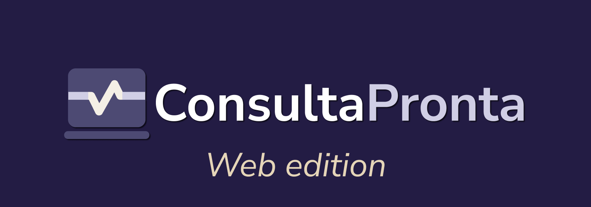

ConsultaPronta é uma plataforma para triagem, direcionamento e acompanhamento da saúde do paciente, facilitando a comunicação com profissionais de saúde.

Este repositório contém a aplicação web do projeto ConsultaPronta.

## Começando
Requisitos: Node.js compatível com a versão declarada em `package.json` e npm.
```bash
git clone https://github.com/consulta-pronta/web.git
cd web
npm install
```

Inicie o servidor de desenvolvimento:
```bash
npm run dev
```

## Outros comandos
```bash
npm run type-check  # valida os tipos 
npm run format      # formata seguindo as convenções da código
npm run build       # valida os tipos e gera a versão de produção
```

## Arquitetura
Consulte [docs/ARCHITECTURE.md](docs/ARCHITECTURE.md) para uma visão geral da estrutura e dos principais fluxos da aplicação.
